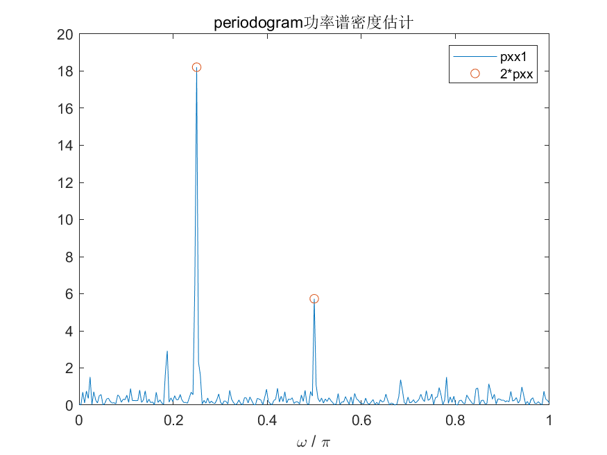

# MATLAB | Spectral Analysis Algorithm | Power Spectral Density Estimation | Include data and plotting code | Directly Useable

1. Basic Definition Periodogram Power Spectral Density Estimation is a frequency estimation method based on Fourier transformation, which can perform spectral analysis on time-domain signals and obtain the energy distribution of signals at different frequencies. Periodogram power spectral density estimation is widely used in signal processing, communication, acoustics and other fields. Compared with traditional spectrum estimation methods, it has better computational efficiency and estimation accuracy. The steps for periodogram power spectral density estimation are as follows:
Given a time-domain signal x(n) of length N.
Perform preprocessing operations such as windowing and FFT on the signal to obtain its frequency domain representation.
Perform the amplitude square operation on the frequency domain representation, obtaining an estimate of the power spectral density of the signal.
Normalize the power spectral density estimation values to obtain normalized power spectral density estimates. The advantage of periodogram power spectral density estimation is its simplicity in computation and ease of implementation, which also provides a good estimation effect for harmonics and other nonlinear components present in the signal. However, when the length of the signal N is large, the estimated results may have a larger variance, and the estimation effect for higher-order harmonics and other higher-order components in the signal may not be as effective as other methods.
2 Definition and drawing effect. The following is the drawing effect:
\n        \n  
Video tutorial operation:
\n        \n          \n          \n          \n          \n            To view this video please enable JavaScript, and consider upgrading to a\n            web browser that\n            supports HTML5 video\n  

## Images

<!-- PAYMENT_BLOCK -->

## Get this dataset

- Payment link (Stripe): [Buy now](https://buy.stripe.com/3cs8yP7sY87d0vu9AB)
- Payment QR code: 

<!-- /PAYMENT_BLOCK -->
